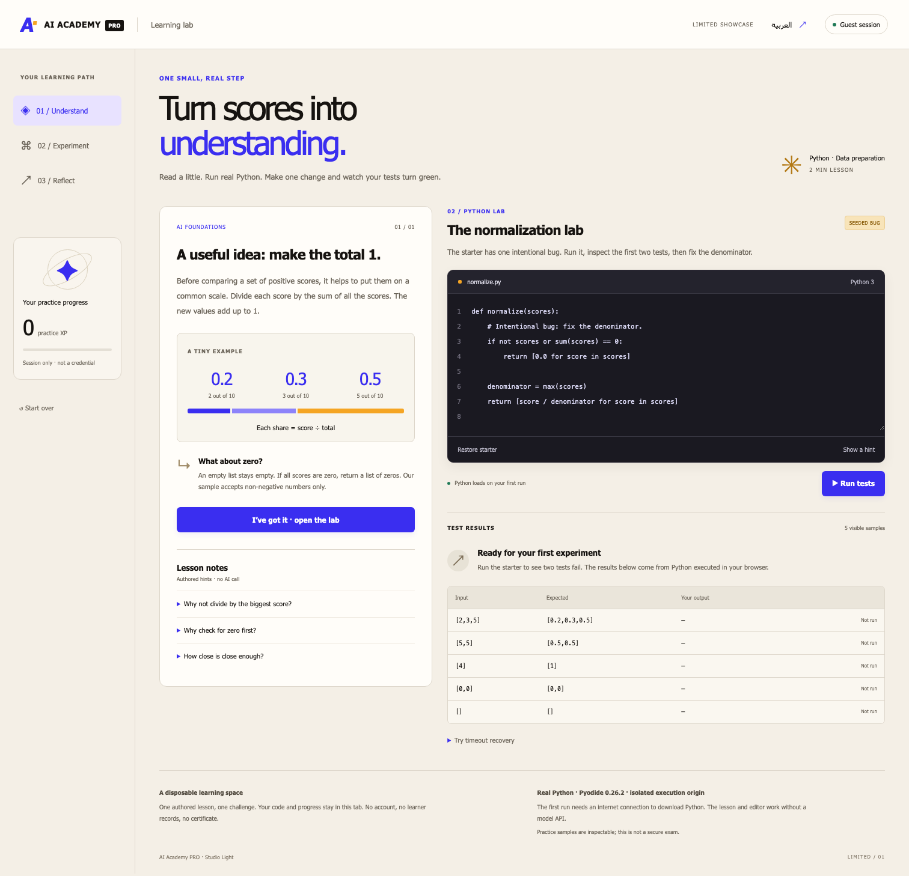
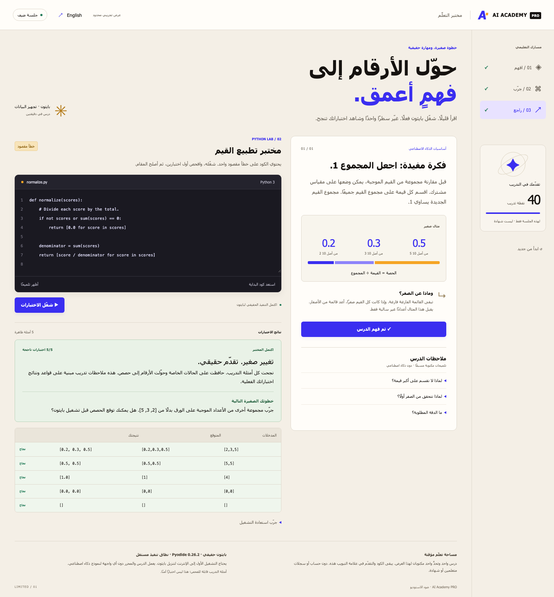

# AI Academy PRO

**Learn a concept. Break the code. Make it work.**

A coding lesson should prove that the learner's edit works. AI Academy PRO turns a bilingual lesson into executable Python practice with visible failures, corrections and progress.

Built by **Mohammed Abumtary** · Node.js · browser JavaScript · Web Workers · Pyodide · EN/AR

[Demo guide](docs/DEMO.md) · [Engineering notes](docs/ENGINEERING.md) · [Verification & boundaries](docs/VERIFICATION.md) · [Recorded walkthrough](media/walkthrough.webm)

## The experience

Read → run the seeded bug → inspect a failure → edit → pass → see progress.

Real Python execution in the browser. This limited lesson uses no model calls and no production student records.

## Where the engineering matters

### Execute the exercise

Pyodide runs the submitted Python in a disposable worker. The feedback comes from the tests rather than a simulated success animation.

### Recover from runaway code

An endless loop is terminated after a bounded deadline. A fresh worker can then run a corrected solution without reloading the lesson.

### Design RTL and code separately

Arabic interface layout follows reading direction while code stays left-to-right. Guest progress is isolated and resettable.

## Verified in the demonstration

- 13 browser checks, including a real 3/5 failure followed by a corrected 5/5 result and 40 XP.
- An actual endless loop was stopped at about four seconds; cancellation and fresh-worker recovery passed.
- Syntax errors, runtime errors, separate guests, mobile reset and unavailable-runtime feedback checked.

## Explore the work

This repository is a presentation package: screenshots, walkthrough media and engineering notes. Application source, credentials and customer records are not included. The interactive demonstration runs in a separate local review environment; access can be arranged for a walkthrough.

[Read the guided demo](docs/DEMO.md) · [View my portfolio](https://mohammed-ab.github.io/)

## Scope

The first Python load needs the runtime CDN. Practice tests are inspectable; this is a learning demo rather than a secure examination system. The optional AI tutor is outside this showcase.

Reviewed 10 November 2026. Results describe the recorded build and stated test scope.
